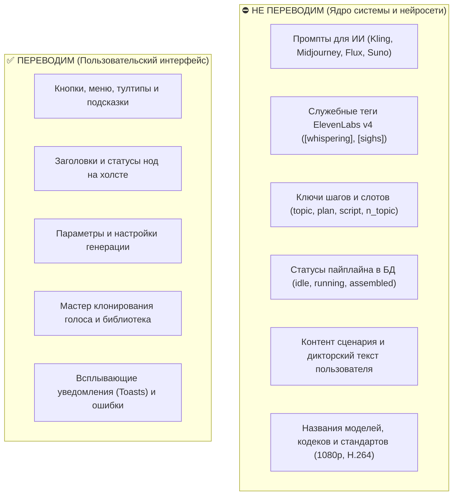

# Концепция и архитектурный план локализации веб-платформы (RU / EN)

> **Статус документа:** На согласовании с владельцем продукта  
> **Дата составления:** 16 ноября 2026 г.  
> **Языки интерфейса:** Русский (по умолчанию), Английский (`ru` / `en`)  
> **Стек платформы:** Next.js 15 (App Router), React 19, Tailwind CSS v4, Zustand, TanStack Query

---

## 1. Цели и принципы локализации

Главная цель — предоставить полноценный англоязычный интерфейс для англоязычных операторов и международных пользователей студии, **сохранив 100% стабильность генерации медиа, точность работы ИИ-агентов и целостность контрактов API**.

### Базовые принципы:
1. **Невмешательство в работу нейросетей:** Генеративные промпты и синтаксические теги нейросетей работают по своим строгим правилам и не зависят от языка интерфейса пользователя.
2. **Мгновенное переключение без перезагрузки:** Смена языка происходит в 1 клик через компактный переключатель `RU | EN` в верхней панели без сброса холста, перезагрузки страницы или потери несохранённых данных.
3. **Безопасность и типобезопасность:** Отсутствие перевода в словаре никогда не должно вызывать «белый экран» (автоматический fallback на русский язык + валидация ключей в TypeScript при сборке).

---

## 2. Что мы КАТЕГОРИЧЕСКИ НЕ переводим (Zero-Translation Scope)

В генеративных медиа-пайплайнах существует ряд сущностей, автоматический перевод которых **приведёт к фатальным сбоям моделей, поломке API-контрактов или ухудшению качества генерации**.



### Подробное обоснование по каждой категории:

| Категория | Что конкретно НЕ переводим | Почему перевод запрещён |
| :--- | :--- | :--- |
| **Генеративные промпты** | Текстовые промпты для видео- и графических нейросетей (*Flux, Midjourney, Kling, Runway, Hailuo, Suno*): `masterpiece, cinematic lighting, 8k, wide shot, slow camera pan` и т.д. | Нейросети обучены преимущественно на англоязычных эмбеддингах. Перевод промптов на другие языки или их изменение под локаль интерфейса ломает генерацию и ухудшает визуальное качество. |
| **Синтаксические теги ElevenLabs v4** | Аудио-теги эмоций и эффектов: `[whispering]`, `[sighs]`, `[laughter]`, `[gasp]`, `[clears throat]`, `[applause]` | Это строгий зарезервированный синтаксис API ElevenLabs v4. Любая русификация или перевод превратит тег в обычный произносимый текст. |
| **Системные ключи шагов и слоты нод** | `topic`, `plan`, `script`, `split`, `hero`, `items`, `images`, `videos`, `audio`, `music`, `sfx_plan`, `sfx_gen`, `assemble`, `publish`, а также слоты `n_topic`, `n_plan` | Это системные идентификаторы в БД SQLite/PostgreSQL, в очередях воркеров и в роутинге API. Переводятся исключительно **отображаемые заголовки карточек на холсте**, но не сами ключи. |
| **Статусы пайплайна и задач** | `idle`, `running`, `done`, `failed`, `pending_approval`, `new`, `assembled`, `paused` | Строгий контракт между фронтендом и фоновым воркером сборки. Переводятся только подписи на интерфейсных бейджах. |
| **Системные категории саунд-дизайна (kind)** | `foley`, `ambience`, `whoosh`, `hit`, `stinger`, `riser`, `transition` | Сам ключ `kind` участвует в сборке звуковой дорожки через FFmpeg и микшер. Переводятся только поясняющие бейджи в UI (`FOLEY · SFX`, `AMBIENCE · Background`). |
| **Пользовательский сценарий ролика** | Название проекта, текст сценария, закадровый дикторский текст, текст на сценах | Это авторский контент проекта. Смена языка интерфейса оператора не должна самовольно переводить создаваемый видеоролик на другой язык. |
| **Бренды, модели и технологии** | `GPT-4o`, `Claude 3.5 Sonnet`, `Kling AI v1.6`, `ElevenLabs`, `Flux Schnell`, `FFmpeg`, `H.264`, `ProRes`, `1080p`, `4K`, `24 fps` | Общепринятые международные стандарты и зарегистрированные торговые марки. |
| **Имена дикторов** | `Adam`, `George`, `Brian`, `Alice`, `Марина`, `Дмитрий` | Имена собственные дикторов в каталогах WaveSpeed и ElevenLabs. |

---

## 3. Что подлежит переводу (Full Translation Scope)

Переводу подлежит **весь управляющий интерфейс, формы, подсказки, модальные окна и системные уведомления**:

### 1. Верхняя панель (Topbar) и навигация:
- Статус сохранения («Сохранено» → *Saved*, «Сохранение...» → *Saving...*).
- Глобальные кнопки запуска («Запустить пайплайн» → *Run Pipeline*, «Пауза» → *Pause*, «Сброс» → *Reset*).
- Меню баланса кредитов/токенов, окно профиля пользователя, роли (*Owner / Admin / Member*).
- Переключатель темы и новый селектор языка (`RU` / `EN`).

### 2. Холст пайплайна (Canvas):
- Названия карточек нод:
  - «Сценарий» → *Script*
  - «Раскадровка» → *Storyboards*
  - «Генерация кадров» → *Image Generation*
  - «Анимация» → *Video Generation*
  - «Озвучка» → *Voiceover*
  - «Музыка» → *Music*
  - «План звуков» → *SFX Plan*
  - «Звуки (SFX)» → *SFX Generation*
  - «Сборка» → *Assembly*
- Статусы нод на карточках («В процессе...» → *In Progress...*, «Готово» → *Ready*, «Ошибка» → *Failed*).
- Контекстные меню ноды («Настройки» → *Settings*, «Результат» → *Result*, «Повторить» → *Retry*).

### 3. Окно результатов нод (Node Result Views):
- Вкладки: «Настройки» / *Settings*, «Результат» / *Result*, «План» / *Plan*.
- Кнопки действий: «Копировать JSON» → *Copy JSON*, «Скачать» → *Download*, «Предпросмотр» → *Preview*.
- Поясняющие плашки и легенда звуков (например, бейджи `FOLEY · SFX`, `AMBIENCE · Background`, `WHOOSH · Movement`, `HIT · Impact`).
- Пустые состояния («Звуки ещё не сгенерированы» → *Sounds have not been generated yet*).

### 4. Окно параметров шагов (Node Step Params):
- Все поля ввода и пояснения («Длина ролика, сек» → *Duration, sec*, «Количество символов» → *Character count*, «Громкость фоновой музыки» → *BGM Volume*).
- Выбор голоса, кнопка открытия библиотеки.

### 5. Голосовая лаборатория и мастер клонирования:
- Библиотека голосов: вкладки («Все» → *All*, «Мои клоны» → *My Clones*, «Каталог» → *Catalog*, «Стандартные» → *Standard*, «История» → *History*).
- Мастер клонирования голоса: шаги мастера («Имя и язык» → *Name & Language*, «Сэмплы» → *Audio Samples*, «Согласие» → *Consent*), правила загрузки и ограничения.

### 6. Уведомления и ошибки (Toasts & Alerts):
- Всплывающие уведомления (Sonner):
  - «План звуков скопирован в буфер» → *Sound plan copied to clipboard*
  - «Выбран голос: {name}» → *Selected voice: {name}*
  - «Проект успешно сохранён» → *Project saved successfully*
  - Сообщения валидации и сетевые ошибки.

### 7. Чат ИИ-агента и контроль изменений (HITL):
- Карточки согласования изменений («Агент предлагает изменить хронометраж сцены» → *AI Agent proposes changing scene duration*).
- Кнопки подтверждения («Применить» → *Approve*, «Отклонить» → *Reject*, «Подробнее» → *Details*).

---

## 4. Архитектурное решение

В проекте используется **Next.js 15 (App Router) с тяжелым интерактивным React-холстом (`@xyflow/react`) и потоковым SSE**. 

> [!IMPORTANT]
> **Мы НЕ используем URL-префиксы (`/en/project/...`, `/ru/project/...`).**  
> Добавление префикса в URL приведёт к полной перезагрузке страниц Next.js, разрыву WebSocket/SSE соединений и лишним проблемам с CORS/аутентификацией API.

### Рекомендуемая архитектура (Lightweight Client-Side i18n):
1. **Хранилище локали:**
   - Хранится в `localStorage` (ключ `via:locale` = `"ru" | "en"`).
   - По умолчанию определяется из языка браузера (`navigator.language`) с безопасным откатом на `"ru"`.
2. **Модульные JSON-словари (`web/src/locales/`):**
   ```
   web/src/locales/
   ├── ru/
   │   ├── common.json        # Базовые действия (Сохранить, Отмена, Закрыть, Поиск)
   │   ├── canvas.json        # Ноды, статусы, таймлайн, карточки
   │   ├── voices.json        # Библиотека голосов, мастер клонирования, теги
   │   ├── sfx.json           # Категории саунд-дизайна и легенда
   │   └── errors.json        # Сообщения об ошибках и валидация
   └── en/
       ├── common.json
       ├── canvas.json
       ├── voices.json
       ├── sfx.json
       └── errors.json
   ```
3. **Типобезопасный хук `useTranslation`:**
   ```tsx
   import { useTranslation } from "@/lib/i18n";

   export function MyComponent() {
     const { t, locale, setLocale } = useTranslation();
     return (
       <button onClick={() => setLocale(locale === "ru" ? "en" : "ru")}>
         {t("common.save")}
       </button>
     );
   }
   ```
4. **Защита от сбоев (Strict Fallback):**
   - Если ключ отсутствует в английском словаре, хук моментально возвращает русский текст. Интерфейс никогда не падает.
   - TypeScript проверяет пути ключей во время `npm run typecheck`.

---

## 5. План поэтапного внедрения

| Этап | Содержание работ | Трудоёмкость | Риски |
| :--- | :--- | :---: | :---: |
| **Этап 1: Инфраструктура** | Создание i18n Store, хука `useTranslation`, базовых словарей `common.json`, добавление кнопки `RU / EN` в Topbar. | 1 день | Нулевые (не затрагивает логику) |
| **Этап 2: Холст и карточки нод** | Перевод названий нод, статусов на карточках, контекстных меню и базовых элементов холста. | 1-2 дня | Низкие |
| **Этап 3: Параметры и результаты** | Перевод окна настроек шагов (`NodeStepParamsPanel`), результатов (`NodeResultViews`), легенды SFX. | 2 дня | Низкие |
| **Этап 4: Голосовой модуль и мастер** | Перевод библиотеки голосов, мастера клонирования, строк выбора и аудио-тегов. | 1 день | Низкие |
| **Этап 5: Уведомления и чат ИИ** | Перевод всплывающих тостов (Sonner), карточек подтверждений агента и страницы профиля. | 1-2 дня | Низкие |

---

## 6. Резюме для владельца

- **Ничего лишнего не сломается:** промпты нейросетей, теги ElevenLabs v4, контракты FFmpeg и бэкенд остаются нетронутыми в оригинале.
- **Интерфейс станет понятен зарубежным операторам:** все кнопки, окна, подсказки и статусы получат профессиональный английский перевод.
- **Внедрение безболезненное:** делается по модульным этапам без простоя системы и без разрыва URL-адресов.
